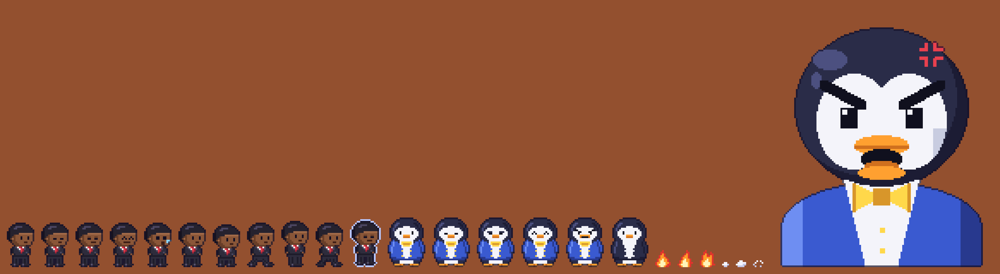
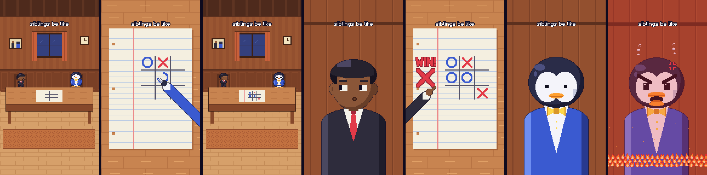
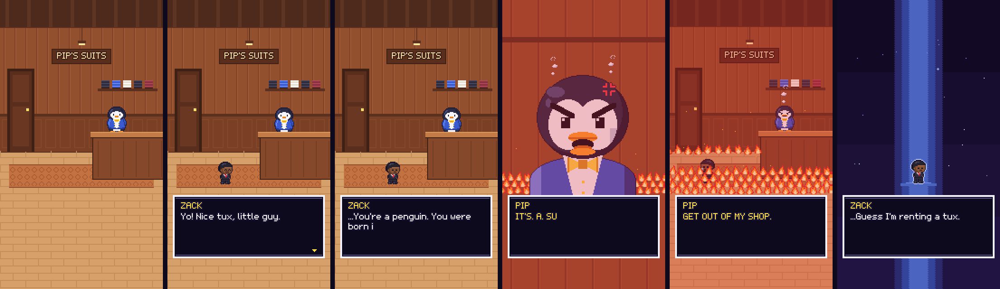

# Pixel shorts — Zack & Pip

A tiny Python engine for vertical (9:16) pixel-art shorts in a Deltarune-like
style, plus the shorts made with it. The style rules live in
[`STYLE.md`](STYLE.md).

| Short | File | Length |
|---|---|---|
| **siblings be like** (with audio) | `renders/siblings.mp4` | 12.0 s, loops |
| **PIP'S SUITS** (silent) | `renders/suit_shop.mp4` | 24.7 s, loops |

## Cast

| | |
|---|---|
| **Zack** | Dark skin, black hair, black suit, white shirt, red tie (accent). 26 px tall. 3/4 view, faces: `normal`, `blink`, `deadpan`, `happy`, `shock`. 4-frame walk, 2-pose idle. |
| **Pip** | A penguin who is (almost) always in a suit: royal-blue jacket, yellow bow tie, orange beak and feet (accents). Faces: `normal`, `blink`, `deadpan`, `smug`, `angry`. `cast.pip(suit=False)` gives him the day off. Close-up: `cast.pip_closeup("blank" / "angry")`. |

Zack also has a close-up (`cast.zack_closeup`) with eyes that have whites, so a
sideways glance reads on a phone: `normal`, `side1`, `side2`, `whistle`.
`cast.arm("zack" | "pip", "pen" | "point")` makes a sleeve-and-hand that
reaches into insert shots.



## siblings be like (12 s, loops, with audio)



| Time | Shot | Sound |
|---|---|---|
| 0:00–0:01 | Wide: Zack and Pip at the table, blank tic-tac-toe on the paper. Caption "siblings be like" (stays up the whole time). | Chiptune loop, bar A |
| 0:01–0:04 | Paper insert. Pip (blue O) and Zack (red X) trade 5 snappy moves, each pen darting in from its owner's side. Pip ends with a fork. | Scribbles, a pop per mark, bar B |
| 0:04–0:06 | Wide: Pip smug. Cut to Zack close-up: hold, then his eyes slide off to the side and he starts whistling. | Record scratch, music stops, "heh heh", crickets, innocent whistle |
| 0:06–0:08 | Insert: Zack draws a huge X in the paper's margin, hand-letters **WIN!** above it and points at it. Held for a full beat. | Two big marker strokes, ta-da |
| 0:08–0:10 | Pip close-up: blank stare... then angry. Red tint fades in, shake, steam, fire rises in front. | Dead silence, then boom, rumble, angry screech, crackle |
| 0:10–0:12 | Hard cut to the opening frame. | Music bar B, which leads straight back into bar A at 0:00 |

The audio is synthesized in code (`pixelshort/audio.py`: square, triangle, sine
and noise voices) to match the 8-bit look, and is muxed in as AAC.

## PIP'S SUITS (24.7 s, loops, silent)



1. Zack walks into Pip's suit shop.
2. **ZACK:** "Yo! Nice tux, little guy." / **PIP:** "It is a SUIT. I sell suits."
3. Beat. **ZACK:** "...You're a penguin. You were born in a tux." Beat.
4. *Hard cut* — Pip close-up: red tint fades in, screen shake, steam, fire rising. **"IT'S. A. SUIT."**
5. *Hard cut* — the shop on fire, Zack backs out. **"GET OUT OF MY SHOP."**
6. *Hard cut* — the dark: Zack alone in a light beam. **"...Guess I'm renting a tux."**
7. *Hard cut* to the opening frame, so the video loops.

## Render

Needs Python 3, `numpy`, `Pillow` and `ffmpeg`.

```bash
python3 render.py siblings                 # -> renders/siblings.mp4 (with audio)
python3 render.py suit_shop                # -> renders/suit_shop.mp4
python3 render.py siblings --watermark @yourname   # small corner watermark
python3 render.py siblings --stills 0,52,90        # also save those art frames as PNG
python3 tools/sheet.py                     # -> renders/sprite_sheet.png
```

## How the style rules are enforced

- **Resolution:** native canvas is **180×320**, upscaled ×6 with nearest-neighbour
  in numpy (`Canvas.upscale`). 180×320 is the size closest to the requested
  ~160×284 that reaches 1080×1920 by a *whole-number* factor. 160×284 would need
  a ×6.76 scale, which makes some art pixels 6 px and others 7 px wide.
  Each art pixel is exactly 6×6 output pixels on even boundaries, so 4:2:0
  chroma never blurs across a pixel edge.
- **Safe margins:** the top and bottom 32 px (10%) hold only background; the
  dialogue box sits at y 216–286.
- **Sprites:** written as ASCII grids (`pixelshort/cast.py`), one character per
  palette key. Outlines are generated automatically: each edge pixel becomes the
  neighbouring fill colour pushed 72% toward dark navy. Black hair gets a
  navy-black edge, the blue jacket a dark-blue one, and nothing is pure black.
  `rim=` adds a light outer outline for dark scenes.
- **Close-ups:** `pixelshort/shapes.py` draws large sprites from flat shapes
  onto the same character grid. They go through the same palette and outline
  pipeline, so the rules don't change at the larger size.
- **Expressions:** whole face rows are swapped, never blended.
- **Timing:** art runs at 12 fps; each frame is held for 2 output frames at
  24 fps. Idle poses are held for 6 art frames, and beats hold with no text so
  the jokes land.
- **Effects** (`pixelshort/effects.py`): 3-tone, 3-frame flames placed in
  repeating rows that stack upward as the fire grows, with rising embers;
  1–2 px random shake with no easing; a flat red overlay that steps up to 26%
  over 6 frames.
- **Text:** a hand-made variable-width pixel font (`pixelshort/font.py`) with a
  white or yellow fill, a 1 px dark border and a typewriter reveal.

## Layout

```
pixelshort/    engine: canvas, sprite, font, cast, shapes, backgrounds, effects, textbox, audio, encode
scenes/        shot lists (siblings.py, suit_shop.py)
tools/         sprite sheet exporter
renders/       output MP4 + preview images
```
